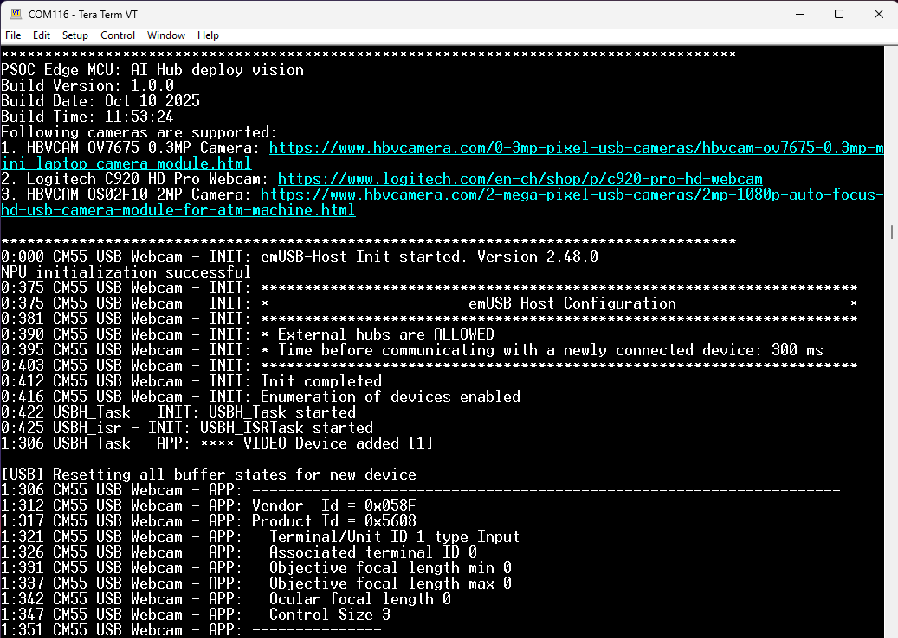
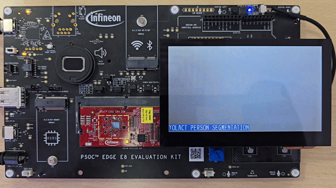

# PSOC&trade; Edge MCU: AI Hub deploy vision

This code example demonstrates a real-time human segmentation detection that uses a USB camera to capture live video and person segmentation model from [DEEPCRAFT&trade; - Model Zoo for PSOC&trade;](https://github.com/Infineon/deepcraft-model-zoo-for-psoc) to detect human segmentation in the video feed using ModusToolbox&trade;. The detected human segmentations are highlighted by drawing a bounding box around the human segmentation and displaying the corresponding text in a text box on the display.

This code example has a three-project structure: CM33 secure, CM33 non-secure, and CM55 projects. All three projects are programmed to the external QSPI flash and executed in Execute in Place (XIP) mode. Extended boot launches the CM33 secure project from a fixed location in the external flash, which then configures the protection settings and launches the CM33 non-secure application. Additionally, CM33 non-secure application enables CM55 CPU and launches the CM55 application.

[View this README on GitHub.](https://github.com/Infineon/mtb-example-psoc-edge-ml-aihub-deploy-vision)

[Provide feedback on this code example.](https://yourvoice.infineon.com/jfe/form/SV_1NTns53sK2yiljn?Q_EED=eyJVbmlxdWUgRG9jIElkIjoiQ0UyNDIxNDYiLCJTcGVjIE51bWJlciI6IjAwMi00MjE0NiIsIkRvYyBUaXRsZSI6IlBTT0MmdHJhZGU7IEVkZ2UgTUNVOiBBSSBIdWIgZGVwbG95IHZpc2lvbiIsInJpZCI6InNhbmRlZXAuYWtAaW5maW5lb24uY29tIiwiRG9jIHZlcnNpb24iOiIxLjEuMCIsIkRvYyBMYW5ndWFnZSI6IkVuZ2xpc2giLCJEb2MgRGl2aXNpb24iOiJNQ0QiLCJEb2MgQlUiOiJJQ1ciLCJEb2MgRmFtaWx5IjoiUFNPQyJ9)

See the [Design and implementation](docs/design_and_implementation.md) for the functional description of this code example.

## Requirements

- [ModusToolbox&trade;](https://www.infineon.com/modustoolbox) v3.7 or later (tested with v3.7)
- Board support package (BSP) minimum required version: 1.0.0
- Programming language: C
- Associated parts: All [PSOC&trade; Edge MCU](https://www.infineon.com/products/microcontroller/32-bit-psoc-arm-cortex/32-bit-psoc-edge-arm) parts

## Supported toolchains (make variable 'TOOLCHAIN')

- GNU Arm&reg; Embedded Compiler v14.2.1 (`GCC_ARM`) – Default value of `TOOLCHAIN`
- LLVM Embedded Toolchain for Arm&reg; v19.1.5 (`LLVM_ARM`)

> **Note:**
> - IAR is not supported by the TensorFlow Lite for Microcontrollers (TFLM) library
> - This code example fails to build in RELEASE mode with the `GCC_ARM` toolchain v14.2.1 as it does not recognize certain Helium instructions of the CMSIS-DSP library. This issue is not present in the Arm&reg; Compiler for Embedded (armclang)

## Supported kits (make variable 'TARGET')

- [PSOC&trade; Edge E84 Evaluation Kit](https://www.infineon.com/KIT_PSE84_EVAL) (`KIT_PSE84_EVAL_EPC2`) – Default value of `TARGET`

## Hardware setup

This example uses the board's default configuration. See the kit user guide to ensure that the board is configured correctly.

Ensure the following jumper and pin configuration on the board:
- The BOOT SW must be in the HIGH/ON position
- J20 and J21 must be in the tristate/not connected (NC) position

### Supported camera and display

- Connect any of the following cameras to the USB host port on the kit:
  - [HBVCAM OV7675 0.3MP MINI Camera](https://www.hbvcamera.com/0-3mp-pixel-usb-cameras/hbvcam-ov7675-0.3mp-mini-laptop-camera-module.html)  
  - [Logitech C920 HD Pro Webcam](https://www.logitech.com/en-ch/shop/p/c920-pro-hd-webcam)  
  - [Logitech C920e Business Webcam](https://www.logitech.com/en-ch/products/webcams/c920e-business-webcam)  
  - [HBVCAM OS02F10 2MP Camera](https://www.hbvcamera.com/2-mega-pixel-usb-cameras/2mp-1080p-auto-focus-hd-usb-camera-module-for-atm-machine.html)  

- **Waveshare 4.3 inch Raspberry Pi DSI 800 x 480 display:**  
  Connect the FPC 15-pin cable between the display connector and the PSOC&trade; Edge E84's RPI MIPI DSI connector as shown in **Table 1** and **Figure 1**

   **Table 1. Cable connection between display connect and kit**

   Kit name                                      | DSI connector
   ----------------------------------------------- | --------------
   PSOC&trade; Edge E84 Evaluation Kit             | J39

    

  **Figure 1. Display connection with PSOC&trade; Edge E84 Evaluation Kit**

  

## Software setup

See the [ModusToolbox&trade; tools package installation guide](https://www.infineon.com/ModusToolboxInstallguide) for information about installing and configuring the tools package.

Install a terminal emulator if you do not have one. Instructions in this document use [Tera Term](https://teratermproject.github.io/index-en.html).

This example requires no additional software or tools.

## Switching the boot flow to an external OSPI flash

The PSOC&trade; Edge E84 Evaluation Kit supports booting from the following two external memories:
- Quad Serial Peripheral Interface (QSPI) flash
- Octal Serial Peripheral Interface (OSPI) flash

This code example is configured to boot from the external QSPI flash by default. For large models (>10 MB), configure the application to boot from the external OSPI flash by following the steps given below.

### Boot from the external OSPI flash

Boot from an external OSPI flash performs the following:

- As a prerequisite, follow the steps in the "Getting started" section in the [AN237849 – Getting Started with the PSOC&trade; Edge security](https://www.infineon.com/AN237849) to generate your keys and certificates and to provision the device for ownership transfer
- Provision the PSOC&trade; Edge E84 Evaluation Kit with the correct extended boot policy configurations required for switching the boot flow to Octal SPI. For details about provisioning and policy configurations, see the "Switching between Octal and Quad SPI external flash memory" section in the [AN237849 – Getting started with the PSOC&trade; Edge security](https://www.infineon.com/AN237849)
- In the example, copy the *design.modus* and *design.cyqspi* files provided in the "OSPI_config" folder and replace them under *\<project_location\>/bsps/\<bsp_name\>/config* folder
- Clean and build the application, then follow the steps provided in **Operation** section

> **Note:** Once the application is switched to boot from OSPI, to execute any other code examples including the [Hello world](https://github.com/Infineon/mtb-example-psoc-edge-hello-world) code example, provision the PSOC&trade; Edge E84 Evaluation Kit again with correct extended boot policy configurations for switching the boot flow to QSPI flash. For details about provisioning and policy configurations, see the "Switching between Octal and Quad SPI external flash memory" section in the [AN237849 – Getting started with the PSOC&trade; Edge security](https://www.infineon.com/AN237849).

## Operation

See [Using the code example](docs/using_the_code_example.md) for instructions on creating a project, opening it in various supported IDEs, and performing tasks, such as building, programming, and debugging the application within the respective IDEs.

1. Connect the board to your PC using the provided USB cable through the KitProg3 USB connector

2. Open a terminal program and select the KitProg3 COM port. Set the serial port parameters to 8N1 and 115200 baud

3. Connect the USB camera to the kit's USB host port and display as mentioned in the [Supported camera and display](#supported-camera-and-display) section

4. After programming, the application starts automatically. Confirm that "PSOC Edge MCU: AI Hub deploy vision" is displayed on the UART terminal and the kit will start capturing video from the USB camera

   **Figure 2. Terminal output on program startup for deploy vision**

   

5. Perform gestures in front of the camera. The display will show the live video feed with bounding boxes and labels for detected human gestures

   **Figure 3. Display output for recognized human segmentation detection**

   

6. Ensure that **USER LED** is turned **ON** when the human segmentation is detected

## Related resources

Resources  | Links
-----------|----------------------------------
Application notes  | [AN235935](https://www.infineon.com/AN235935) – Getting started with PSOC&trade; Edge E8 MCU on ModusToolbox&trade; software   [AN237849](https://www.infineon.com/AN237849) – Getting started with the PSOC&trade; Edge security
Code examples  | [Using ModusToolbox&trade;](https://github.com/Infineon/Code-Examples-for-ModusToolbox-Software) on GitHub
Device documentation | [PSOC&trade; Edge MCU datasheets](https://www.infineon.com/products/microcontroller/32-bit-psoc-arm-cortex/32-bit-psoc-edge-arm#documents)   [PSOC&trade; Edge MCU reference manuals](https://www.infineon.com/products/microcontroller/32-bit-psoc-arm-cortex/32-bit-psoc-edge-arm#documents)
Development kits | Select your kits from the [Evaluation board finder](https://www.infineon.com/cms/en/design-support/finder-selection-tools/product-finder/evaluation-board)
Libraries  | [mtb-dsl-pse8xxgp](https://github.com/Infineon/mtb-dsl-pse8xxgp) – Device support library for PSE8XXGP   [retarget-io](https://github.com/Infineon/retarget-io) – Utility library to retarget STDIO messages to a UART port
Tools  | [ModusToolbox&trade;](https://www.infineon.com/modustoolbox) – ModusToolbox&trade; software is a collection of easy-to-use libraries and tools enabling rapid development with Infineon MCUs for applications ranging from wireless and cloud-connected systems, edge AI/ML, embedded sense and control, to wired USB connectivity using PSOC&trade; Industrial/IoT MCUs, AIROC&trade; Wi-Fi and Bluetooth&reg; connectivity devices, XMC&trade; Industrial MCUs, and EZ-USB&trade;/EZ-PD&trade; wired connectivity controllers. ModusToolbox&trade; incorporates a comprehensive set of BSPs, HAL, libraries, configuration tools, and provides support for industry-standard IDEs to fast-track your embedded application development

 

## Other resources

Infineon provides a wealth of data at [www.infineon.com](https://www.infineon.com) to help you select the right device, and quickly and effectively integrate it into your design.

## Document history

Document title: *CE242146* – *PSOC&trade; Edge MCU: AI Hub deploy vision*

 Version | Description of change
 ------- | ---------------------
 1.0.0   | New code example
 1.1.0   | Updated the code example to boot from QSPI flash by default
 

All referenced product or service names and trademarks are the property of their respective owners.

The Bluetooth&reg; word mark and logos are registered trademarks owned by Bluetooth SIG, Inc., and any use of such marks by Infineon is under license.

PSOC&trade;, formerly known as PSoC&trade;, is a trademark of Infineon Technologies. Any references to PSoC&trade; in this document or others shall be deemed to refer to PSOC&trade;.

---------------------------------------------------------

(c) 2026, Infineon Technologies AG, or an affiliate of Infineon Technologies AG. All rights reserved.
This software, associated documentation and materials ("Software") is owned by Infineon Technologies AG or one of its affiliates ("Infineon") and is protected by and subject to worldwide patent protection, worldwide copyright laws, and international treaty provisions. Therefore, you may use this Software only as provided in the license agreement accompanying the software package from which you obtained this Software. If no license agreement applies, then any use, reproduction, modification, translation, or compilation of this Software is prohibited without the express written permission of Infineon.
 
Disclaimer: UNLESS OTHERWISE EXPRESSLY AGREED WITH INFINEON, THIS SOFTWARE IS PROVIDED AS-IS, WITH NO WARRANTY OF ANY KIND, EXPRESS OR IMPLIED, INCLUDING, BUT NOT LIMITED TO, ALL WARRANTIES OF NON-INFRINGEMENT OF THIRD-PARTY RIGHTS AND IMPLIED WARRANTIES SUCH AS WARRANTIES OF FITNESS FOR A SPECIFIC USE/PURPOSE OR MERCHANTABILITY. Infineon reserves the right to make changes to the Software without notice. You are responsible for properly designing, programming, and testing the functionality and safety of your intended application of the Software, as well as complying with any legal requirements related to its use. Infineon does not guarantee that the Software will be free from intrusion, data theft or loss, or other breaches (“Security Breaches”), and Infineon shall have no liability arising out of any Security Breaches. Unless otherwise explicitly approved by Infineon, the Software may not be used in any application where a failure of the Product or any consequences of the use thereof can reasonably be expected to result in personal injury.
